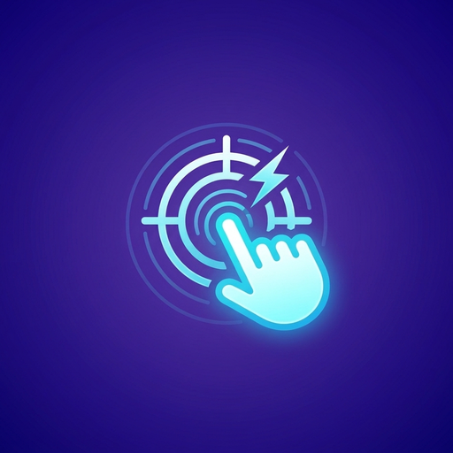
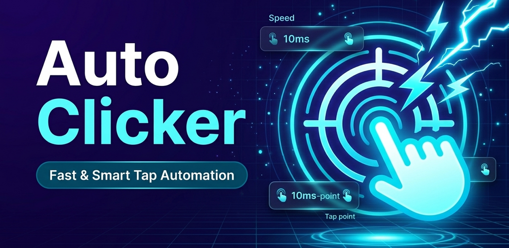

<p align="center">
  
</p>

<h1 align="center">Auto Clicker for Android</h1>

<p align="center">
  A modern, high-performance, and privacy-first Android touch automation and gesture clicking utility.<br/>
  Built with <b>Kotlin</b>, <b>Jetpack Compose (Material 3)</b>, and Android's native <b>AccessibilityService API</b>.
</p>

<p align="center">
  
  
  
  
  
  
</p>

<p align="center">
  
</p>

---

## 📖 Overview

**Auto Clicker** is an open-source Android application designed for rapid, repeated, and sequenced touch gestures on any app or game without requiring root privileges. Whether you need repeated taps for incremental games, complex multi-point automated workflows, or rapid multi-column rhythm game tap bars, Auto Clicker provides seamless floating controls and millisecond-level precision.

### 🌟 Key Highlights

- ⚡ **No Root Access Required**: Automates touch events entirely through standard Android Accessibility gesture dispatching (`dispatchGesture`).
- 🎛️ **Floating Overlay Toolbar**: Draggable on-screen sidebar overlay (`WindowManager`) to start, pause, add, remove, and reposition target pins directly over third-party apps and games.
- 📐 **Dual Orientation Sidebar**: Toggle between vertical and horizontal floating sidebar layouts to stay out of the way in both portrait apps and landscape games.
- 🎯 **Three Distinct Operating Modes**:
  1. **Single-Target Mode**: Ultra-fast continuous clicking at a single screen point with customizable intervals and press duration.
  2. **Multi-Target Mode**: Sequence through multiple user-placed targets ($P_1 \to P_2 \to P_3 \dots$) with per-point or global intervals, delays, and loop limits.
  3. **Configurable Grid Mode**: Bottom-screen grid generator ($16\times2$, $10\times2$, $5\times3$, etc.) tailored for rhythm games, piano tiles, and RPG action bars with customizable order patterns.
- 🎲 **Anti-Detection & Randomization**:
  - **Temporal Jitter ($\pm\Delta t$)**: Adds randomized variance to click intervals to simulate human-like rhythm.
  - **Spatial Radius ($\pm\Delta r$)**: Randomizes tap positions within a configured pixel radius around each target marker.
- ⏱️ **Flexible Stop Conditions**: Run indefinitely, stop after an exact iteration count, or stop automatically after a set duration (minutes).
- 📱 **Android Quick Settings Tile**: Swipe down the Android status bar and toggle Auto Clicker instantly from the Quick Settings shade.
- 🧪 **Built-in Interactive Test Bench**:
  - **Speed & CPS Test**: Live Clicks-Per-Second (CPS) counter, peak CPS gauge, and visual tap ripple canvas.
  - **Sequence Test**: Validates multi-point ordering and timing ($1 \to 2 \to 3$).
  - **Grid Auto-Click Simulator**: Visual cell grid for testing bottom-screen tap configurations.
  - **Live Click Log**: Real-time stream of tap timestamps, intervals ($\Delta t$), target IDs, and screen coordinates $(X, Y)$.
- 🔒 **100% Private & Completely Offline**: Does not declare `android.permission.INTERNET`. Zero data collection, zero network tracking, and zero analytics.

---

## 🕹️ Clicker Modes

```
               ┌─────────────────────────────────────────────────────┐
               │                  Auto Clicker Modes                 │
               └──────────────────────────┬──────────────────────────┘
                                          │
            ┌─────────────────────────────┼─────────────────────────────┐
            ▼                             ▼                             ▼
┌───────────────────────┐     ┌───────────────────────┐     ┌───────────────────────┐
│      Single Mode      │     │      Multi Mode       │     │       Grid Mode       │
├───────────────────────┤     ├───────────────────────┤     ├───────────────────────┤
│ • 1 Target Pin        │     │ • Infinite Targets    │     │ • Configurable Grids  │
│ • Down to 1ms interval│     │ • Sequence order (P1→)│     │   (e.g., 16×2, 10×2)  │
│ • Infinite / Count /  │     │ • Individual delays   │     │ • Bottom screen zone  │
│   Duration stop rules │     │ • Global loop control │     │ • Row/Col/Random/Alt  │
└───────────────────────┘     └───────────────────────┘     └───────────────────────┘
```

### 1. Single Target Mode
Continuously fires clicks at one precise location on the screen.
- Configurable interval between clicks (milliseconds).
- Configurable tap press duration (down to 10–20ms for instant taps).
- Stop rules: **Infinite**, **Click Count Limit**, or **Time Duration**.
- Anti-detection temporal and spatial jitter.

### 2. Multi-Target Mode
Executes an ordered sequence across multiple target markers placed on the screen.
- Dynamically add (`+`) or remove (`−`) target markers from the floating sidebar or settings.
- Drag each numbered pin independently to any screen coordinate.
- Customize individual delay times per point or apply global sequence intervals.
- Loop counter: repeat $N$ times or loop indefinitely until paused.

### 3. Grid Mode (Landscape & Action Games)
Generates an evenly spaced matrix of tap points occupying the bottom portion of the display (default: 28% screen height).
- Ideal for horizontal/landscape games, piano tiles, rhythm keyboards, or wide toolbar automation.
- Grid dimension presets: $16 \times 2$, $10 \times 2$, $8 \times 2$, $5 \times 3$, or fully custom column/row counts.
- Multiple execution traversal strategies:
  - **Bottom Row First**: Fires the bottom-most row left-to-right, then upper rows.
  - **Top Row First / Left-to-Right**: Standard sequential scanning.
  - **Column-by-Column**: Traverses columns vertically across the display.
  - **Alternating (Boustrophedon)**: Alternates direction between consecutive rows.
  - **Random**: Randomly fires across active grid cells.
  - **Custom Cell Sequence**: Pick specific cells to activate in exact custom sequences.

---

## 🛠️ Tech Stack & Architecture

| Layer | Technology |
|---|---|
| **Language** | [Kotlin 2.2.10](https://kotlinlang.org/) |
| **Android SDK** | Min SDK 28 (Android 9.0 Pie) • Target SDK 36 • Compile SDK 36 |
| **UI Framework** | [Jetpack Compose](https://developer.android.com/jetpack/compose) with Material Design 3 |
| **Build System** | Gradle 9.3.1 with Kotlin DSL (`build.gradle.kts`) & Foojay Toolchains |
| **Android Gradle Plugin** | AGP 9.1.1 |
| **Concurrency** | Kotlin Coroutines (`Dispatchers.Default`, `Dispatchers.Main`) & StateFlow / SharedFlow |
| **Storage** | Local Android `SharedPreferences` (Private App Sandbox) |
| **Service Framework** | `AccessibilityService`, `ForegroundService`, `TileService` |

### Architectural Design
Auto Clicker adheres to **Unidirectional Data Flow (UDF)**:
- **`ClickerController` (Singleton Engine)**: Central reactive brain holding single-source-of-truth states (`StateFlow<SingleClickConfig>`, `StateFlow<List<ClickPoint>>`, `StateFlow<Boolean>`). Runs clicking loops in background coroutines with non-blocking delays and safe lifecycle cancellation.
- **`AutoClickerAccessibilityService`**: Native system service responsible for invoking `dispatchGesture(GestureDescription, ...)` based on coordinates dispatched by `ClickerController`.
- **`FloatingOverlayService`**: Foreground service managing draggable floating window layouts (`WindowManager`) for the floating toolbar and individual pin overlays (`TYPE_APPLICATION_OVERLAY`).
- **`AutoClickerTileService`**: System Quick Settings tile integration for toggling click automation from anywhere on Android.
- **Jetpack Compose UI**: Modern single-activity scaffold (`MainActivity`) containing the Dashboard, Settings, and interactive Test Bench screens.

---

## 🔒 Permissions & Privacy

Auto Clicker was built with privacy and Android platform integrity as top priorities:

| Permission | Identifier | Necessity & Purpose |
|---|---|---|
| **Accessibility Service** | `android.permission.BIND_ACCESSIBILITY_SERVICE` | Required strictly to perform simulated click gestures on screen coordinates via `dispatchGesture`. |
| **Display Over Other Apps** | `android.permission.SYSTEM_ALERT_WINDOW` | Required to render floating target pins and the draggable control sidebar over target applications. |
| **Foreground Service** | `android.permission.FOREGROUND_SERVICE` & `FOREGROUND_SERVICE_SPECIAL_USE` | Ensures the overlay controls and clicking engine remain responsive in the background without system termination. |
| **Post Notifications** | `android.permission.POST_NOTIFICATIONS` | Displays a lightweight foreground service notification to show status and allow immediate stopping. |

> [!IMPORTANT]
> **Zero Internet & Zero Tracking**:
> Auto Clicker **does not** request `android.permission.INTERNET`. No network calls, telemetry, or analytics SDKs are bundled. All configuration profiles and target coordinates remain strictly inside your device's private storage. Review our comprehensive [Privacy Policy](POLICY.md) for full compliance disclosures.

---

## 🚀 Building & Running

### Prerequisites
- **JDK 21** (Required by Gradle 9.x daemon)
- **Android SDK** with Platform API 36 installed
- Android device or emulator running **Android 9.0 (API 28)** or higher

### Build Commands

```bash
# Clone the repository
git clone https://github.com/username/AutoClicker.git
cd AutoClicker

# Build Debug APK
./gradlew assembleDebug

# Build Release APK
./gradlew assembleRelease

# Run JVM Unit Tests
./gradlew testDebugUnitTest

# Run Android Lint Check
./gradlew lintDebug
```

The compiled APK will be located at:
```
app/build/outputs/apk/debug/app-debug.apk
```

### Installing via ADB

```bash
adb install -r app/build/outputs/apk/debug/app-debug.apk
```

---

## 📱 Quick Start Guide

1. **Grant Permissions**:
   - Open **Auto Clicker**.
   - On the Dashboard, tap **Enable** for **Accessibility Service** and enable `Auto Clicker` in Android Settings.
   - Tap **Enable** for **Display Over Other Apps** and allow overlay drawing.
2. **Choose Mode**:
   - Select **Single**, **Multi**, or **Grid** mode on the Dashboard.
3. **Launch Sidebar**:
   - Tap **Launch Side Bar**. The floating toolbar will appear on the side of your screen.
4. **Position Targets**:
   - Switch to your target game or application.
   - Drag the numbered circular marker(s) directly over the buttons or positions you wish to click.
5. **Control Clicks**:
   - Tap **▶** on the floating toolbar to begin automated clicking.
   - Tap **⏸** to pause anytime.
   - Use **+** and **−** to add/remove points on the fly (Multi mode).
   - Use the **Eye** icon to temporarily hide target circles.
   - Use the **Rotate** icon to flip the sidebar between vertical and horizontal orientations.
   - Use the **✕** button to close the floating toolbar.

---

## 🧪 Interactive Test Bench

Navigate to the **Click Test** tab in the app to access our built-in testing suite:
- **Speed & CPS Test**: Test click throughput, measure real-time Clicks-Per-Second, and test your own manual tapping speed against automated speeds.
- **Sequence Verification**: Verify multi-target timing and ordering with automated sequence checkmarks.
- **Grid Auto-Click Bench**: Interactive bottom grid canvas to test matrix coordinate calculations and ordering before launching games.
- **Live Event Log**: Inspect exact coordinate hits, timestamp differences, and execution logs in real time.

---

## 📂 Project Directory Layout

```
AutoClicker/
├── app/
│   ├── src/
│   │   ├── main/
│   │   │   ├── AndroidManifest.xml          # Permissions, Activity, & Services declaration
│   │   │   ├── java/app/kiddos/autoclicker/
│   │   │   │   ├── MainActivity.kt          # Main UI host & NavigationRail/BottomBar
│   │   │   │   ├── controller/
│   │   │   │   │   └── ClickerController.kt # Central state machine & clicking coroutine
│   │   │   │   ├── data/
│   │   │   │   │   └── ClickerPreferences.kt# SharedPreferences persistence
│   │   │   │   ├── model/
│   │   │   │   │   └── ClickerConfig.kt     # Data models (Single, Multi, Grid, Points)
│   │   │   │   ├── service/
│   │   │   │   │   ├── AutoClickerAccessibilityService.kt # Gesture dispatcher
│   │   │   │   │   ├── AutoClickerTileService.kt          # Quick Settings shade tile
│   │   │   │   │   └── FloatingOverlayService.kt          # WindowManager floating UI
│   │   │   │   ├── ui/
│   │   │   │   │   ├── screen/
│   │   │   │   │   │   ├── DashboardScreen.kt # Permissions & mode launcher
│   │   │   │   │   │   ├── SettingsScreen.kt  # Detailed configuration tabs
│   │   │   │   │   │   └── TestAppScreen.kt   # CPS tester & log inspector
│   │   │   │   │   └── theme/               # Material 3 colors, shapes, & type
│   │   │   │   └── util/
│   │   │   │       └── PermissionUtils.kt   # System intent helpers
│   │   │   └── res/                         # Vector icons, drawables, & strings
│   │   └── test/java/                       # JVM unit tests & grid scheduler tests
│   └── build.gradle.kts                     # App-level build configuration
├── gradle/libs.versions.toml                # Gradle Version Catalog
├── POLICY.md                                # Google Play compliant Privacy Policy
└── README.md                                # Project documentation
```

---

## 🤝 Contributing

Contributions, bug reports, and feature requests are welcome!
1. Fork the repository.
2. Create your feature branch (`git checkout -b feature/awesome-feature`).
3. Commit your changes (`git commit -m 'feat: add awesome feature'`).
4. Ensure all unit tests pass (`./gradlew testDebugUnitTest`).
5. Push to the branch (`git push origin feature/awesome-feature`).
6. Open a Pull Request.

---

## 📄 License & Legal Notice

This project is released under the [MIT License](LICENSE) (or applicable open-source license).

**Disclaimer**: Auto Clicker is designed for productivity, accessibility assistance, and testing purposes. Please use responsibly and respect the Terms of Service of third-party games and applications.
